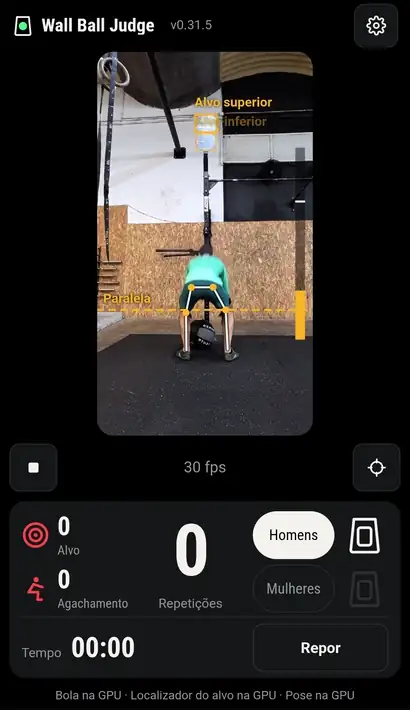

# Wall Ball Judge

Wall Ball Judge judges wall balls with your device's camera. It counts a rep when the hips go below the knees and the ball then hits the athlete's target, and it calls a no-rep when either fails. It runs in the browser, and the video stays on the device.

Try the app at [wallballs.app](https://wallballs.app/).

## Object-detection model

- [The detection model](https://huggingface.co/RodrigoQuelhas/hyrox-wallballs-detection): the ball and target detectors the app runs, and how they were trained.
- [The dataset](https://huggingface.co/datasets/RodrigoQuelhas/wallballs): what the detectors were trained on.

## Licence

The app is MIT. The object-detection model is AGPL-3.0.
